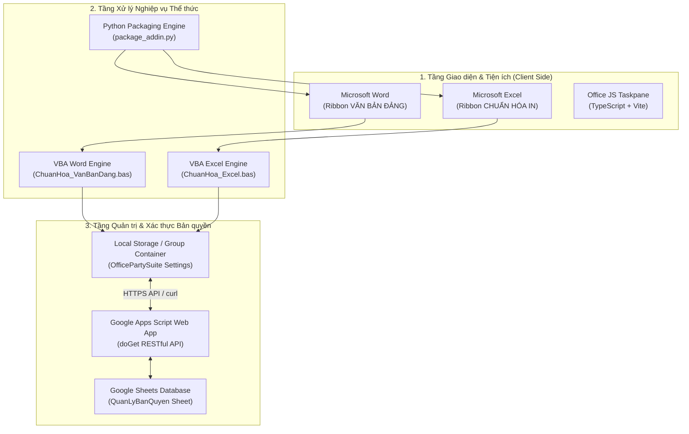

# 🏛️ HỆ THỐNG ADD-IN CHUẨN HÓA THỂ THỨC VĂN BẢN ĐẢNG & BẢNG BIỂU IN ẤN EXCEL

> **Cơ quan chủ quản & Phát triển:** Văn phòng Đảng ủy xã Thạnh Phú  
> **Căn cứ pháp lý & Kỹ thuật:**  
> * **Quy định số 66-QĐ/TW** ngày 06/02/2017 của Ban Bí thư Trung ương Đảng về thể thức văn bản của Đảng.  
> * **Hướng dẫn số 05-HD/VPTW** ngày 27/5/2026 của Văn phòng Trung ương Đảng về thể thức và kỹ thuật trình bày văn bản của Đảng *(thay thế Hướng dẫn 36-HD/VPTW ngày 03/4/2018)*.

---

## 📋 MỤC LỤC
1. [Bối cảnh & Mục tiêu dự án](#-bối-cảnh--mục-tiêu-dự-án)
2. [Kiến trúc Giải pháp Kỹ thuật](#-kiến-trúc-giải-pháp-kỹ-thuật)
3. [Chi tiết Tính năng & Thuật toán cốt lõi](#-chi-tiết-tính-năng--thuật-toán-cốt-lõi)
   - [Module Word: Chuẩn hóa thể thức văn bản Đảng](#1-module-word-chuanhoa_vanbandang)
   - [Module Excel: Chuẩn hóa bảng biểu & trang in A4](#2-module-excel-chuanhoa_excel)
   - [Module License: Quản trị & Xác thực bản quyền Serverless](#3-module-license-hệ-thống-bản-quyền-serverless)
4. [Cấu trúc Thư mục Dự án](#-cấu-trúc-thư-mục-dự-án)
5. [Hướng dẫn Cài đặt Dành cho Người dùng (End-User)](#-hướng-dẫn-cài-đặt-dành-cho-người-dùng)
6. [Hướng dẫn Sử dụng Chi tiết](#-hướng-dẫn-sử-dụng-chi-tiết)
7. [Hướng dẫn Quản trị Hệ thống Cấp phép (Dành cho Quản trị viên)](#-hướng-dẫn-quản-trị-hệ-thống-cấp-phép)
8. [Hướng dẫn Dành cho Lập trình viên (Developer Guide)](#-hướng-dẫn-dành-cho-lập-trình-viên)

---

## 🎯 BỐI CẢNH & MỤC TIÊU DỰ ÁN

### 1. Bối cảnh thực tế
Tại các cơ quan Đảng, tổ chức chính trị - xã hội từ cấp Trung ương đến địa phương (đặc biệt là cấp xã/phường), công tác văn thư và soạn thảo văn kiện đòi hỏi sự chuẩn mực tuyệt đối theo Hướng dẫn của Ban Chấp hành Trung ương. Tuy nhiên:
* **Mất nhiều thời gian chỉnh sửa thủ công:** Cán bộ thường phải tự rà soát cỡ chữ từng đoạn, thụt lề, khoảng cách dòng, độ dài đường kẻ phân cách, căn chỉnh nơi nhận và vị trí chữ ký.
* **Lỗi in ấn bảng biểu Excel:** Các báo cáo thống kê, phụ lục ngân sách, danh sách Đảng viên khi in ấn thường xuyên bị **mất chữ trong các ô gộp dòng (merged cells)**, ngắt trang lộn xộn, tiêu đề bảng không tự lặp lại ở các trang sau.
* **Rào cản triển khai phần mềm:** Máy tính cơ quan thường không có quyền Administrator để cài đặt phần mềm bên ngoài (.exe), thiếu kinh phí thuê máy chủ cloud (VPS/Server) riêng để quản lý cấp phép bản quyền.

### 2. Mục tiêu dự án
Xây dựng một giải pháp tiện ích văn phòng **toàn diện - siêu nhẹ - bảo mật cao**:
* **1-Click Chuẩn hóa:** Tự động nhận diện cấu trúc và hoàn thiện văn bản/bảng tính chỉ với 1 thao tác duy nhất.
* **Không cần quyền Admin:** Hoạt động dưới dạng Native Add-in (OpenXML Ribbon + VBA), cài đặt tức thì vào thư mục Startup của người dùng.
* **Hỗ trợ đa nền tảng:** Tương thích đồng thời cả **Windows** (10/11) và **macOS** (MacBook M-series & Intel).
* **Quản trị bản quyền 0 đồng (Serverless):** Tận dụng hệ sinh thái Google Sheets + Google Apps Script Web App để làm hệ cơ sở dữ liệu và API xác thực từ xa bảo mật theo phần cứng máy tính.

---

## 🏗️ KIẾN TRÚC GIẢI PHÁP KỸ THUẬT

Dự án được xây dựng theo mô hình kiến trúc phân tầng:



---

## ⚡ CHI TIẾT TÍNH NĂNG & THUẬT TOÁN CỐT LÕI

### 1. Module Word (`ChuanHoa_VanBanDang`)

Áp dụng chính xác các tỷ lệ chuyển đổi quy chuẩn ($1\,\text{mm} \approx 2.83465\,\text{pt}$):
* **Page Setup chuẩn A4:**
  * Lề trên (*Top*): $20\,\text{mm}$ ($56.7\,\text{pt}$).
  * Lề dưới (*Bottom*): $20\,\text{mm}$ ($56.7\,\text{pt}$).
  * Lề trái (*Left*): $30\,\text{mm}$ ($85.0\,\text{pt}$).
  * Lề phải (*Right*): $15\,\text{mm}$ ($42.5\,\text{pt}$).
  * Vùng văn bản khả dụng: $165\,\text{mm} \times 257\,\text{mm}$.
* **Quy chuẩn Font & Đoạn văn (Typography):**
  * Phông chữ: `Times New Roman`.
  * Cỡ chữ nội dung: `14 pt` (hoặc `13 pt`).
  * Thụt đầu dòng: Chuẩn `1.27 cm (0.5 inch)`.
  * Giãn đoạn: Cách trước (*Space Before*) `6 pt`, cách sau `0 pt`.
  * Giãn dòng: `Single` hoặc `Exactly 18-22 pt`.
* **Thuật toán phân tích cấu trúc văn bản phân cấp:**
  1. *Khối Tiêu ngữ & Cơ quan ban hành:* Căn giữa, cỡ chữ 12-13pt in hoa đậm; tự động vẽ đường kẻ phân cách có độ dài bằng $1/3$ đến $1/2$ độ dài dòng chữ.
  2. *Số, Ký hiệu & Ngày tháng địa danh:* In nghiêng, căn chỉnh đúng tọa độ lề phải.
  3. *Tên loại văn bản & Trích yếu:* Tự động nhận dạng Nghị quyết, Quyết định, Chỉ thị, Quy định, Kế hoạch... Đối với công văn, trích yếu "V/v..." size 12-13pt in nghiêng, "Kính gửi" size 14pt thụt lề chuẩn.
  4. *Khối Nơi nhận:* Cỡ chữ 11-12pt, "Nơi nhận:" in đậm nghiêng, danh sách cơ quan nhận gạch đầu dòng căn lề trái.
  5. *Khối Chữ ký:* Tự động chèn khoảng cách 4 dòng Enter chuẩn để chừa chỗ ký tên và đóng dấu.

---

### 2. Module Excel (`ChuanHoa_Excel`)

* **Thuật toán tự động nhận diện Table Header (Tiêu đề bảng):**
  * Quét thông minh 25 dòng đầu của trang tính.
  * Nhận diện các từ khóa đặc trưng: `STT`, `Mã`, `Họ và tên`, `Nội dung`, `Đơn vị tính`, `Số lượng`, `Ghi chú`...
  * Hỗ trợ bảng tiêu đề phức tạp gồm 2 tầng gộp ô (Merge Cells).
  * Tự động thiết lập cấu hình in: `PrintTitleRows = "$X:$Y"` để lặp lại tiêu đề bảng trên tất cả các trang in.
* **Thuật toán nới chiều cao ô gộp (Merged Cells AutoFit Height):**
  * Trong Excel mặc định, tính năng `AutoFit Row Height` **không hoạt động trên các ô đã gộp dòng/cột**, dẫn đến chữ bị mất khi in ra giấy.
  * Module giải quyết bằng thuật toán: Tạm thời rã gộp ô (Unmerge) vào ô phụ, áp dụng Wrap Text và tính toán chiều cao nội dung theo số ký tự và độ rộng cột, sau đó chia đều hoặc áp đặt chiều cao dòng chính xác rồi gộp lại, bảo đảm **hiển thị 100% văn bản**.
* **Chuẩn hóa khổ giấy in A4 Landscape:**
  * Hướng in: Khổ ngang (*Landscape*).
  * Căn lề in: Trái 15mm, Phải 15mm, Trên 15mm, Dưới 15mm.
  * Tự động co giãn: `FitToPagesWide = 1`, `FitToPagesTall = False` (vừa vặn 1 trang ngang, chiều dài cuộn tự nhiên theo dữ liệu).

---

### 3. Module License: Hệ thống Bản quyền Serverless

* **Không cần máy chủ riêng (Zero Server Cost):** Tận dụng Google Sheets làm Cơ sở dữ liệu và Google Apps Script làm API RESTful.
* **Khóa bản quyền theo phần cứng (Machine-bound Activation):**
  * Windows: Nhận diện `COMPUTERNAME` / `USERNAME`.
  * macOS: Nhận diện `ComputerName` qua `scutil` / `hostname`.
  * Mỗi mã kích hoạt cấp phát chỉ sử dụng được trên **01 máy tính duy nhất**.
* **Cơ chế chia sẻ bản quyền (Shared License Suite):**
  * Kích hoạt trên Word $\rightarrow$ Excel tự động được mở khóa và ngược lại.
  * Lưu trữ an toàn tại `OfficePartySuite` trong Group Container của macOS và Windows Registry.
* **Hỗ trợ chế độ Offline:** Máy tính đã kích hoạt vẫn hoạt động bình thường kể cả khi mất kết nối Internet tạm thời.
* **Khóa từ xa tức thì (Remote Revocation):** Quản trị viên chỉ cần chuyển trạng thái sang `"Đã khóa"` trên Google Sheet, phần mềm trên máy trạm sẽ tự động bị thu hồi quyền và ngừng hoạt động ngay trong lần bấm tiếp theo.

---

## 📁 CẤU TRÚC THƯ MỤC DỰ ÁN

```plaintext
doc-party-addin/
├── Bo_Cai_Dat_AddIn_VanBanDang.zip  # Gói cài đặt trọn gói phân phối cho cán bộ
├── ChuanHoa_VanBanDang.dotm         # Add-in nhúng Ribbon dành cho Microsoft Word
├── ChuanHoa_VanBanDang.bas          # Source code VBA chuẩn hóa văn bản Word
├── ChuanHoa_Excel.xlam              # Add-in nhúng Ribbon dành cho Microsoft Excel
├── ChuanHoa_Excel.bas               # Source code VBA chuẩn hóa bảng tính Excel
├── CaiDat_AddIn_Windows.bat         # Script cài đặt tự động 1-Click trên Windows
├── GoCaiDat_Windows.bat             # Script gỡ cài đặt hoàn toàn trên Windows
├── CaiDat_AddIn_Mac.sh              # Script cài đặt tự động trên macOS
├── HuongDan_DongNghiep.txt          # Hướng dẫn sử dụng nhanh dành cho người dùng
├── package_addin.py                 # Engine Python tự động nhúng Ribbon OpenXML & đóng gói ZIP
├── taskpane.html                    # Giao diện Web Add-in Office JS (mở rộng)
├── vite.config.ts                   # Cấu hình Vite build Office JS
├── tsconfig.json                    # Cấu hình TypeScript
├── package.json                     # Quản lý dependencies (Node.js)
├── src/                             # Mã nguồn TypeScript dự án Office JS
│   ├── constants.ts                 # Toàn bộ thông số kích thước thể thức Đảng
│   ├── formatService.ts             # Thuật toán định dạng Word JavaScript API
│   ├── index.ts                     # Điểm khởi chạy Add-in
│   ├── taskpane.ts                  # Xử lý tương tác giao diện người dùng
│   ├── taskpane.css                 # Thiết kế giao diện Taskpane hiện đại
│   └── types.ts                     # Khai báo kiểu dữ liệu định dạng
└── README.md                        # Tài liệu chi tiết dự án
```

---

## 💻 HƯỚNG DẪN CÀI ĐẶT DÀNH CHO NGƯỜI DÙNG

### Dành cho máy tính Windows (10/11)
1. Tải về và giải nén tệp `Bo_Cai_Dat_AddIn_VanBanDang.zip`.
2. Đóng hoàn toàn Microsoft Word và Excel.
3. Nhấp đúp chuột vào tệp **`CaiDat_AddIn_Windows.bat`**.
4. Màn hình console xuất hiện dòng chữ:  
   `[+] CÀI ĐẶT THÀNH CÔNG 100%! VUI LÒNG MỞ WORD / EXCEL ĐỂ SỬ DỤNG.`  
   là đã hoàn tất (quá trình mất chưa đầy 3 giây).

### Dành cho máy tính macOS (Apple Silicon / Intel)
1. Tải về và giải nén `Bo_Cai_Dat_AddIn_VanBanDang.zip`.
2. Đóng Microsoft Word và Excel.
3. Mở ứng dụng **Terminal**, kéo tệp **`CaiDat_AddIn_Mac.sh`** vào cửa sổ Terminal rồi nhấn `Enter`.

---

## 📖 HƯỚNG DẪN SỬ DỤNG CHI TIẾT

### Bước 1: Kích hoạt bản quyền lần đầu
1. Mở Word hoặc Excel.
2. Trên thanh Menu Ribbon, chọn thẻ **VĂN BẢN ĐẢNG** $\rightarrow$ Bấm nút **Chuẩn Hóa Thể Thức** (hoặc **Chuẩn Hóa Bảng Tính**).
3. Hộp thoại hiện ra: Nhập mã kích hoạt được cấp (ví dụ: `TP-A1B2`) $\rightarrow$ Bấm **OK**.
4. Hệ thống báo: **"Kích hoạt bản quyền thành công!"**. Từ lúc này, toàn bộ tính năng sẽ mở khóa vĩnh viễn trên máy tính.

### Bước 2: Sử dụng trên Word
* Mở bất kỳ văn bản nào cần định dạng $\rightarrow$ Chọn tab **VĂN BẢN ĐẢNG** $\rightarrow$ Bấm **Chuẩn Hóa Thể Thức**.
* Toàn bộ font chữ, tiêu đề, tiêu ngữ, đường kẻ, thụt dòng, giãn đoạn và chữ ký sẽ được hoàn thiện tức thì.

### Bước 3: Sử dụng trên Excel
* Mở bảng tính báo cáo $\rightarrow$ Chọn tab **CHUẨN HÓA IN** (hoặc nhóm **IN ẤN A4** tại thẻ Trang đầu/Home) $\rightarrow$ Bấm **Chuẩn Hóa Trang In**.
* Bảng tính tự động xoay ngang, mở rộng các dòng gộp ô tránh mất chữ và thiết lập căn lề hoàn hảo để in hoặc xuất file PDF.

---

## ⚙️ HƯỚNG DẪN QUẢN TRỊ HỆ THỐNG CẤP PHÉP

Hệ thống quản lý bản quyền được vận hành trực tiếp trên bảng tính Google Sheet:

### 1. Cấp mã mới cho cán bộ
1. Mở file Google Sheet **Quản lý bản quyền**.
2. Trên thanh công cụ, bấm menu **🔑 QUẢN LÝ BẢN QUYỀN** $\rightarrow$ Chọn **➕ Cấp mã kích hoạt mới**.
3. Nhập tên cán bộ / đơn vị nhận và ghi chú $\rightarrow$ Bấm **OK**.
4. Hệ thống tự động sinh mã ngẫu nhiên chuẩn `TP-XXXX`, tự động sao chép 100% định dạng (Dropdown trạng thái xanh/đỏ, kẻ viền ô) và thêm vào danh sách.
5. Sao chép mã gửi cho cán bộ để kích hoạt.

### 2. Thu hồi / Khóa mã từ xa
1. Tìm dòng của cán bộ hoặc thiết bị cần khóa trong Google Sheet.
2. Tại cột **Trạng thái**, nhấp vào Dropdown và chọn sang: **`Đã khóa`** (chuyển sang màu đỏ).
3. Ngay trong lần thao tác tiếp theo trên máy tính đó, Add-in sẽ báo lỗi bản quyền bị khóa và tự động vô hiệu hóa.

---

## 🛠️ HƯỚNG DẪN DÀNH CHO LẬP TRÌNH VIÊN

### Yêu cầu môi trường
* **Python 3.8+** (dùng cho engine đóng gói OpenXML Ribbon).
* **Node.js 18+** & **npm** (dùng khi phát triển module Office JS Web Add-in).

### Quy trình đóng gói lại Add-in sau khi sửa code
Khi bạn thực hiện chỉnh sửa trong `ChuanHoa_VanBanDang.bas` hoặc `ChuanHoa_Excel.bas`:
1. Chạy lệnh tự động đóng gói:
   ```bash
   python3 package_addin.py
   ```
2. Script sẽ tự động:
   * Nhúng cấu trúc OpenXML `customUI14.xml` vào file `.dotm` và `.xlam`.
   * Cập nhật trực tiếp vào thư mục Startup Office của máy đang phát triển để kiểm thử ngay.
   * Đóng gói toàn bộ các script cài đặt và tài liệu vào file zip phân phối: `Bo_Cai_Dat_AddIn_VanBanDang.zip`.

---

## ⚖️ BẢN QUYỀN & GIẤY PHÉP

Dự án được xây dựng và phát hành phục vụ công tác văn phòng nội bộ tại **Văn phòng Đảng ủy xã Thạnh Phú**.  
Mọi quyền sở hữu trí tuệ và quyền tác giả thuộc về nhóm phát triển Văn phòng Đảng ủy xã Thạnh Phú.
